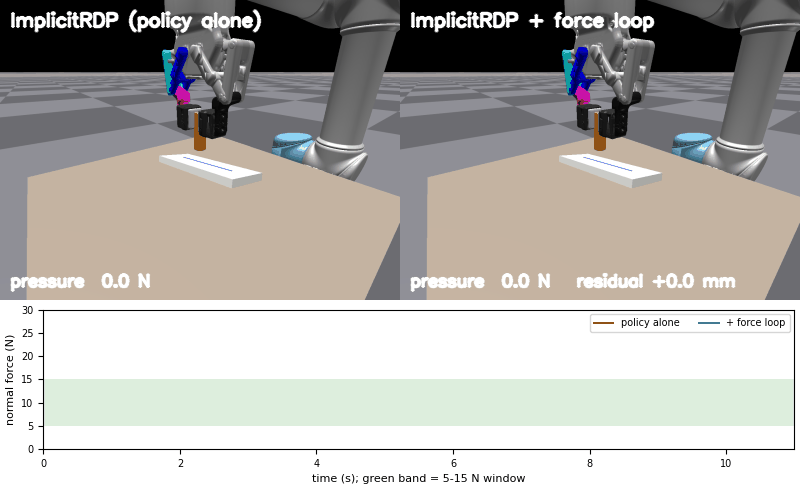
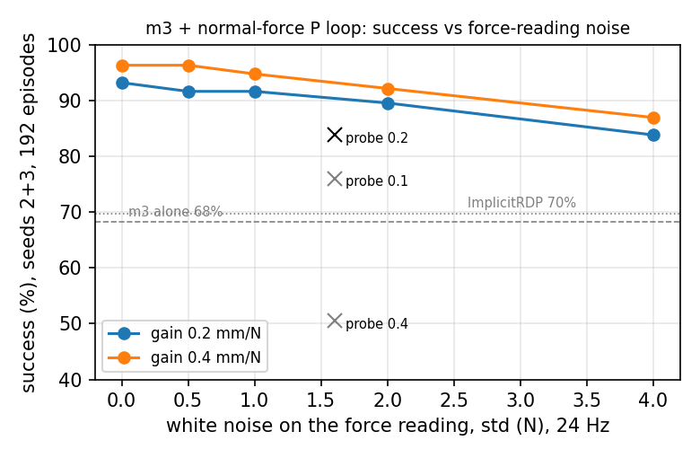

[中文](README.md) | **English**

# ImplicitRDP + a force loop: does tactile *prediction* actually help? A controlled sim study



*Same episode (seed 8). Left: ImplicitRDP on its own. Right: the same policy with a hard-coded proportional normal-force loop wrapped around it. Bottom: live pressure traces; the green band is the task's 5–15 N window.*

## One sentence

On a board-wiping task in Isaac Gym / TacSL (the board shakes, the camera's pose estimate is noisy and late), wrapping a **hard-coded proportional normal-force loop** around ImplicitRDP raises the success rate from **70% to 84%** (pressure read linearly out of the policy's hidden state) or **96%** (true simulated pressure, i.e. what a fingertip force sensor would give on a real robot). Replacing "current pressure" in that loop by "predicted pressure 4 steps ahead" is **not better**. Per-frame white noise on the force reading barely hurts (4 N costs 6–9 points); **errors that persist for a few steps, and bias that depends on the pressure level, are what hurt**.

This is not a new method. It is a set of controls answering a question the literature leaves open: **do tactile-prediction methods gain from the *prediction*, or from *having a fast loop that looks at pressure every step*?** On this task, the latter.

## The question

OmniVTA, TacPAC and similar works feed predicted tactile signals to a fast layer as a reference and report large gains, but their ablations lack a "measured only, no prediction" row (TacPAC has one, but its predictive variant differs from that baseline in more than the prediction). Here the two ingredients are separated and tested one at a time.

## Setup

| | |
|---|---|
| Task | Wipe v2: UR5 + Robotiq 2F-85 + simulated GelSight Mini (TacSL). A tool is pressed on a board and dragged along a line; the board shakes 1–2 mm along its normal; the camera's estimate of the board pose is noisy and delayed. Success = enough of the line wiped **and** pressure rules (5–15 N window, never above 15 N for 0.5 s, never above 40 N). A scripted expert scores 100%. |
| Control | 24 Hz position commands, 120 Hz physics. |
| Policy | Minimal reimplementation of ImplicitRDP (arXiv:2512.10946), `sim/implicit_rdp_lite.py`: Transformer denoiser + GRU fast token, one slow token per 32-step chunk, one fast token per step, 5 DDIM steps of re-denoising every step. **m0** = as published; **m3** = plus a 64-frame history and an auxiliary tactile-prediction loss (nothing extra at deployment; alone it performs like m0, see below). |
| Force loop | Every step: `d = clip(K · (f̂ − 10 N), ±3 mm)` along the **estimated** board normal, added to that step's position command; active only while f̂ > 2 N (in contact); not integrated; invisible to the policy network. |
| Three sources of f̂ | **now**: a linear probe reads the current pressure from the GRU state h_t (held-out R² 0.85); **ahead**: the same h_t, probe for the pressure 4 steps later (R² 0.67; "assume it stays" gives 0.64); **oracle**: true simulated pressure (= a fingertip force sensor on the real robot). |
| Evaluation | Board shaking, seeds 2 and 3, 96 episodes each (the probe is fitted on seed-1 states, never on the evaluation seeds). Episode conditions are identical across variants for a given seed, so paired McNemar tests apply. |

## Results

### 1. The loop helps; all of the gain comes from "look at pressure every step", none from prediction

Success, seeds 2 + 3 pooled (192 episodes):

| Fast-layer reading | K = 0.1 mm/N | 0.2 | 0.4 |
|---|---|---|---|
| now (probe, current pressure) | 76.0% | **83.9%** | 50.5% |
| ahead (probe, 4 steps ahead) | 74.5% | 77.6% | 70.8% |
| oracle (true current pressure) | — | 93.2% | **96.4%** |
| no loop (m3 alone) | 68.2% | | |
| ImplicitRDP as published (m0) | 69.8% | | |

Paired McNemar: now 0.2 vs m3 +41 / −11, p < 0.001; vs m0 +42 / −15, p < 0.001. oracle 0.4 vs m3 +55 / −1. now 0.2 vs ahead 0.2 +25 / −13, p = 0.07 (prediction never beats measurement; the ahead > now at K = 0.4 is only because the ahead probe shrinks towards the mean, i.e. a smaller effective gain).

Mechanism: every failure is "line not wiped enough", none is over-pressure. The loop raises the fraction of contact time spent inside the window from 73% to 78% (oracle 84%) and lowers the fraction of the line passed over with too much force from 43% to 37% (oracle 27%). The residual is active on 16–20% of steps, 0.6 mm on average at K = 0.2, never at the 3 mm clip.

For reference, earlier evaluations on the same task: Diffusion Policy 12.5%, RDP 39.6%.

### 2. The reading is the bottleneck: white noise is cheap, correlated error is expensive

True pressure plus i.i.d. Gaussian noise per step (24 Hz):

| noise σ | 0 N | 0.5 | 1 | 2 | 4 |
|---|---|---|---|---|---|
| K = 0.2 | 93.2% | 91.7% | 91.7% | 89.6% | 83.9% |
| K = 0.4 | 96.4% | 96.4% | 94.8% | 92.2% | 87.0% |



The probe's error is not white (contact steps only): rmse 3.7 N, lag-1 autocorrelation 0.59 (correlation time ≈ 2 steps = 80 ms), and biased by pressure level: +1.0 N when the true pressure is 2–6 N, −3.6 N at 14–20 N, −8 N above 20 N (regression to the mean). Against the curve: the probe at K = 0.2 (83.9%) matches 4 N of white noise; the probe at K = 0.4 (50.5%) is far below 4 N of white noise (87%). Jitter that persists for a few steps is chased as if it were signal at high gain; white noise averages out within the robot's response time.

### 3. Three accuracy requirements for a tactile fingertip's force reading (force-regulation tasks)

1. **Per-frame jitter is cheap**: σ ≤ 1 N is essentially free, ≤ 2 N costs under 4 points; no need for heavy filtering or a lower rate.
2. **Errors lasting ≥ 2 control steps (≥ 80 ms) and pressure-dependent bias are expensive**: they set the usable gain (K 0.2 vs 0.4 is a 10-point difference).
3. **Linear range up to and beyond the window's upper edge (≥ 20 N)**: the probe under-reads by 3.6 N at 14–20 N, exactly where the loop must lift.

### Also: tactile prediction as an auxiliary loss did nothing here

m3 (64-frame history + prediction loss) alone is indistinguishable from m0 (three seeds, 288 episodes: 67.4% vs 72.2%, Fisher p = 0.24). The GRU state carries the current pressure (R² 0.85) but almost no future (0.67 vs 0.64 for "assume it stays"). A variant that also fed the just-issued command (efference copy) into the fast loop was copied as a shortcut under behaviour cloning and collapsed to 3.1% closed-loop; it is not expanded on in this repo.

## Honest limits

- Simulation, one task. Wiping fails in exactly one way (pressure out of the window), so a scalar P loop suffices; tasks that need contact geometry (insertion, cable routing) may not behave the same.
- The predictor is weak: the ahead probe is barely better than "assume it stays" and does not see the policy's plan, so it amounts to "now plus noise". A fair test of *prediction* needs a plan-aware predictor (e.g. f̂(t+4) = current pressure + stiffness × planned normal displacement over the next 4 steps). Not done here.
- The force loop itself is textbook hybrid force/position control. The contribution is the controls, not the method.

## Reproduce

### Dependencies

- NVIDIA **Isaac Gym Preview 4** and the **TacSL branch of IsaacGymEnvs** (`isaacgymenvs.tacsl_sensors`, the IndustReal peg asset). NVIDIA-licensed; obtain from NVIDIA, not redistributed here.
- **reactive_diffusion_policy** (MIT, [xiaoxiaoxh/reactive_diffusion_policy](https://github.com/xiaoxiaoxh/reactive_diffusion_policy)): only its `ConditionalUnet1D` is used.
- Python 3.8, PyTorch (the version Isaac Gym needs), `urdfpy`, `scipy`, `zarr`, `numpy`, `matplotlib`, `opencv-python`, `imageio`.
- A 6 GB GPU is enough for evaluation (1.3 GB) and training (3.8 GB).

Directory convention (override with `TACSL_ROOT`, default `~/tacsl`):

```
$TACSL_ROOT/IsaacGymEnvs/        TacSL branch of IsaacGymEnvs (pip install -e)
$TACSL_ROOT/rdp/src/             clone of reactive_diffusion_policy
```

### Checkpoints

Download from this repo's [Releases](../../releases) into `checkpoints/`:

```
checkpoints/wipe_irdp_v2/policy.pt        m0: ImplicitRDP as published (wipe v2, 48000 steps)
checkpoints/wipe_m3/policy.pt             m3: 64-frame history + prediction loss λ=0.3
checkpoints/wipe_irdp_v2/force_calib.pt   force calibration used by m3's prediction head at training time (not needed for evaluation)
```

### Run

```bash
conda activate tacsl
export TACSL_ROOT=~/tacsl
cd sim

# ImplicitRDP alone (seed 2, 96 episodes, board shaking)
WIPE_TASK=v2 python eval_irdp_wipe.py --ckpt ../checkpoints/wipe_irdp_v2/policy.pt --perturb 1 --episodes 96 --seed 2 --no-h \
    --stats ../results/l1/wipe_m0_p1_s2.npz

# + force loop, true pressure, K = 0.4
WIPE_TASK=v2 python eval_irdp_wipe_fast.py --ckpt ../checkpoints/wipe_m3/policy.pt --perturb 1 --episodes 96 --seed 2 --no-h \
    --residual oracle --gain 0.4 --stats ../results/l1/wipe_m3_fast_oracle_g0.4_s2.npz

# the probe (first evaluate m3 on seed 1 without --no-h to get wipe_m3_p1_h.npy)
WIPE_TASK=v2 python eval_irdp_wipe.py --ckpt ../checkpoints/wipe_m3/policy.pt --perturb 1 --episodes 96 --seed 1 --stats ../results/l1/wipe_m3_p1.npz
python fit_force_probe.py ../results/l1/wipe_m3_p1 ../results/probe_m3_force.npz

# the whole grid (now / ahead × K, oracle, noise curve); ~8 min per 96-episode run
bash ../scripts/run_fast_layer.sh
GAINS="0.4" ORACLE_GAINS="0.2 0.4" bash ../scripts/run_fast_layer.sh
NOISE_N="0.5 1 2 4" bash ../scripts/run_fast_layer.sh

# analysis
python mcnemar_fast.py ../results/l1
python noise_curve.py ../results/l1 ../results/noise_curve.png
python probe_error.py ../results/l1

# video (one process per run: Isaac Gym allows one sim per process)
WIPE_TASK=v2 python record_video.py record --label irdp --ckpt ../checkpoints/wipe_irdp_v2/policy.pt --residual none --seed 8 --out ../media/seed8/frames_irdp
WIPE_TASK=v2 python record_video.py record --label loop --ckpt ../checkpoints/wipe_m3/policy.pt --residual oracle --gain 0.4 --seed 8 --out ../media/seed8/frames_loop
python record_video.py compose --left ../media/seed8/frames_irdp --right ../media/seed8/frames_loop --out ../media/wipe
```

`results/l1/` holds the 96-episode statistics behind every number above (`.npz` per episode, `.txt` summaries).

### Training from scratch (optional)

Demos: `WIPE_TASK=v2 python wipe_expert.py --mode expert --episodes 960 --demos 480 --seed 0 --perturb 1 --record data/wipe_demos_v2.zarr` (scripted expert, board shaking, successful episodes only). Train a base checkpoint with `rdp_lite.py` (tactile PCA + DP), then ImplicitRDP with `implicit_rdp_lite.py --task wipe --base <base> --calib <force_calib.pt>`; flags are documented in the docstrings at the top of both files. 48000 steps take about 3.3 h on an RTX 3060.

## Layout

```
sim/                      simulation, expert, policies, evaluation, analysis (all written for this project; assets: see THIRD_PARTY.md)
  insertion_env.py        base environment: UR5 + 2F-85 + GelSight Mini (TacSL tactile)
  wipe_env.py             wiping task: shaking board, camera-estimate errors, success and pressure rules
  wipe_expert.py          scripted expert (integral force loop), episode statistics and summaries
  rdp_lite.py             minimal RDP (tactile PCA, DP, slow/fast layers)
  implicit_rdp_lite.py    minimal ImplicitRDP + history / prediction-head changes
  eval_irdp_wipe.py       evaluation (optionally stores the GRU state every step for the probe)
  eval_irdp_wipe_fast.py  evaluation + force loop (now / ahead / oracle, noise)
  fit_force_probe.py  mcnemar_fast.py  noise_curve.py  probe_error.py  record_video.py
  ur5_2f85_isaacgym/  objects/   robot and board URDFs / meshes
scripts/run_fast_layer.sh pipeline for the whole grid
results/                  all evaluation statistics, probe weights, noise curve
media/                    GIF / mp4
```

## Sources and acknowledgements

- ImplicitRDP: Chen et al., *ImplicitRDP: An End-to-End Visual-Force Diffusion Policy with Structural Slow-Fast Learning*, arXiv:2512.10946, 2025. This repo is a minimal reimplementation from the paper, not the official code.
- RDP: Xue et al., *Reactive Diffusion Policy*, RSS 2025. `ConditionalUnet1D` comes from the official implementation (MIT).
- TacSL / IndustReal: Akinola, Xu et al., NVIDIA (IsaacGymEnvs, BSD-3).
- Robot assets: UR5 (ROS-Industrial, BSD-3), Robotiq 2F-85 (ElectronicElephant's pybullet_ur5_robotiq, BSD), GelSight Mini mesh. See `THIRD_PARTY.md`.

Code under the MIT license. Experiments done in October 2026 on personal hardware, unaffiliated with any institution.
